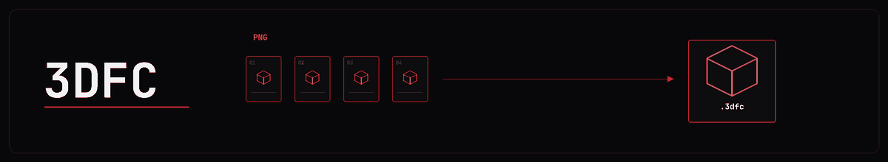

<p align="center">
  
</p>

<p align="center">
  <a href="https://github.com/Vinetwigs/3dfc/tags"></a>
  <a href="LICENSE"></a>
  
  
</p>

<p align="center">
  Archive numbered PNG renders in one file. Restore the full sequence, one frame, or any range with pixel values and alpha preserved.
</p>

<p align="center">
  <a href="#get-started">Get started</a> ·
  <a href="#restore-frames">Restore</a> ·
  <a href="#benchmark">Benchmark</a> ·
  <a href="#safe-archiving">Safe archiving</a> ·
  <a href="#license">License</a>
</p>

---

## Why 3DFC

Finished renders can leave thousands of PNGs on disk long after a project is
complete. 3DFC is designed for that cold storage use case: archive once, verify,
then recover everything or only the frames you need.

- Lossless pixel recovery, including transparency
- Original frame names retained
- Random access to individual frames and inclusive ranges
- Integrity verification before source files are removed
- Adaptive compression with a passthrough fallback for noisy frames
- Interactive terminal interface and scriptable CLI

## Get started

Requires Go 1.24 or later. FFmpeg is optional.

```sh
go build -o 3dfc ./cmd/3dfc

./3dfc archive -in ./renders/shot01 -out ./archive/shot01.3dfc
./3dfc verify -in ./archive/shot01.3dfc
./3dfc extract -in ./archive/shot01.3dfc -out ./restored --all
```

On Windows, the executable is `3dfc.exe`. In PowerShell, replace `./3dfc` in
the examples with `.\3dfc.exe`.

Archive creation reports the source size, archive size, and space saved. View
these figures later with:

```sh
./3dfc info -in ./archive/shot01.3dfc
```

## Restore frames

Frame numbers start at 0 and range endpoints are inclusive. Without a selector,
`extract` restores the entire sequence.

```sh
# One frame
./3dfc extract -in shot01.3dfc -out ./restored --frame 1422

# Frames 0 through 100
./3dfc extract -in shot01.3dfc -out ./restored --upto 100

# Frames 1400 through 1450
./3dfc extract -in shot01.3dfc -out ./restored --from 1400 --to 1450

# All frames
./3dfc extract -in shot01.3dfc -out ./restored --all
```

Extraction does not replace existing files by default. Add `--overwrite` only
when replacement is intended. Files are restored under their original names;
the archive is checked for path traversal and filename collisions first.

## Benchmark

Compression depends on the content. Test representative frames before archiving
a large project:

```sh
./3dfc benchmark -in ./renders/shot01 -preset fast -max 200
```

The benchmark compares available backends on the same frames, verifies each
trial by default, and reports archive size, saved space, encode time, and
throughput.

| Option | Default | Purpose |
|---|---:|---|
| `-backends` | `all` | Compare all available backends or a comma-separated selection |
| `-preset` | `max` | `max` favors size; `fast` favors encoding speed |
| `-max` | `0` | Use the first N frames; `0` uses the full sequence |
| `-verify` | `true` | Verify every trial archive |
| `-keep` | `false` | Keep trial archives after benchmarking |

## Archive options

```sh
./3dfc archive -in ./renders/shot01 -out ./archive/shot01.3dfc \
  -backend auto -preset max -gop 300 -tile 64 -fps 24
```

| Option | Default | Purpose |
|---|---:|---|
| `-backend` | `auto` | `auto`, `go`, or `ffmpeg` |
| `-preset` | `max` | `max` favors size; `fast` favors encoding speed |
| `-gop` | `300` | Maximum frames between keyframes; lower values speed up isolated restores |
| `-tile` | `64` | Tile edge in pixels for the Go backend |
| `-fps` | `24` | Frame rate recorded for FFmpeg segments |
| `-force` | `false` | Replace an existing archive after successful encoding |
| `-resume` | `false` | Save checkpoints and resume an interrupted archive |

The `auto` backend chooses an encoder per group of frames. The Go backend uses
tile-based deltas and zstd. When FFmpeg is available, high-motion groups can use
lossless `x264rgb` with a separate lossless alpha stream. FFmpeg is required to
restore or verify archives that contain FFmpeg segments.

For a long job, enable resume on the first run and repeat the same command if
interrupted:

```sh
./3dfc archive -in ./renders/shot01 -out ./archive/shot01.3dfc -resume
```

Resume checks the source content and encoder settings before continuing from
the last committed group. Keep the source frames unchanged between runs. Use
`-force -resume` to discard an incompatible checkpoint and start over. The
temporary checkpoint files are removed after a successful archive commit.

Progress is reported in two phases, scanning and encoding. Each phase counts the
input frames once, so a 2,000-frame sequence reaches 2,000/2,000 in both phases.

## Terminal interface

Run `3dfc` with no arguments to open the TUI. It provides archive, restore,
benchmark, info, and verify operations.

| Key | Action |
|---|---|
| Up / Down | Navigate the menu |
| 1-5 | Open a menu item directly |
| Tab | Move to the next field |
| Left / Right | Change an option or move the text cursor |
| Enter | Continue or run the operation |
| Esc | Return to the menu |
| Q | Quit from the menu or result screen |

The Archive and Extract forms include explicit `Overwrite` controls. Archive
also provides a `Resume` toggle.

## Safe archiving

Before deleting source frames:

1. Create the archive.
2. Run `verify` and confirm it succeeds.
3. Copy the archive to a second storage device.
4. Restore and inspect a few frames.
5. Only then remove the source sequence.

Keep at least two independent copies of anything you cannot recreate.

## Fidelity and limitations

- Reconstructed pixel values and alpha are lossless. Restored PNG files are
  re-encoded, so their compressed bytes and ancillary metadata are not
  guaranteed to match the source files.
- 16-bit PNGs and groups that would grow when compressed are stored verbatim.
- Small sequences can be larger than their inputs because of container and
  index overhead.
- Numbered filenames are sorted naturally. Gaps and duplicate frame numbers
  are reported as warnings.

## Development

```sh
go test ./...
go vet ./...
```

## License

Copyright (C) 2026 Vinetwigs. Licensed under GPL-3.0-only. See [`LICENSE`](LICENSE).
